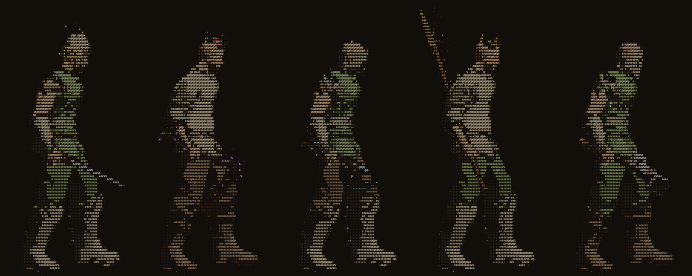
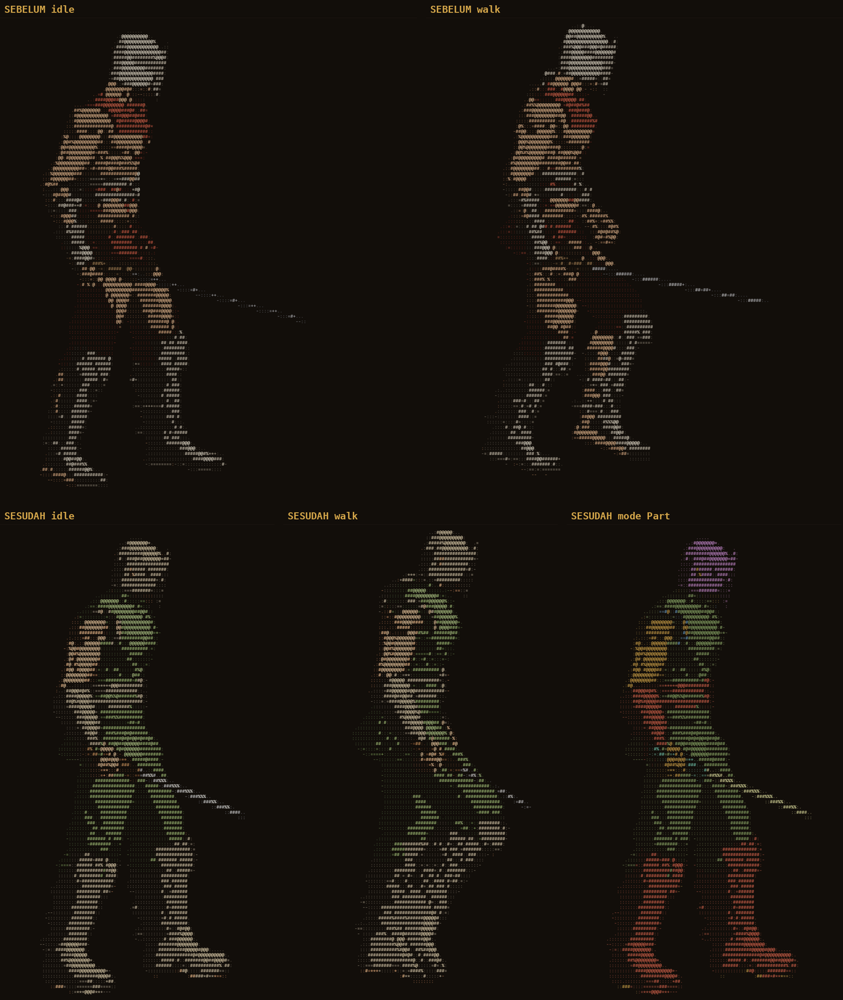

# ascii-bake-lab

Eksperimen pipeline **baked ASCII** untuk portfolio MMORPG medieval: model 3D (glTF) di-render sekali menjadi frame ASCII
(**shade level + part id + depth** per sel), lalu diputar di browser tanpa Three.js. Glyph dan warna final ditentukan
**material** di runtime, jadi material bisa diganti tanpa re-bake.


## Menjalankan

```bash
npm install
npm run dev
```

- `http://localhost:5173/bake.html` → **bake tool** (dev only, pakai Three.js). Atur parameter, klik **Bake**, lalu
  **Simpan ke public/baked/hero.json** (endpoint dev di `vite.config.ts`) atau **Download JSON**.
- `http://localhost:5173/` → **player** (produksi, tanpa Three.js). Idle/walk, arah kiri/kanan (mirror), equipment per slot, aura per slot, putar 16 arah,
  material blade (Iron/Steel/Gold/Bloodiron), rune api, mode warna Material/Part/Depth, penanda socket blade.
  Tahan ← / → untuk berjalan.
- `npm run build` hanya mem-build player. Hasil saat ini: JS 11,5 KB (5,3 KB gzip), Three.js tidak ikut.

## Cara kerja bake

1. Load badan (`.gltf`/`.glb`/`.fbx`), animasi dari file terpisah (`animations: { idle: 'file.glb#Clip' }`), outfit skinned
   yang di-bind ulang ke skeleton badan (`outfits`), dan aksesori yang ditempel ke tulang (`attachments`, mesh-nya
   bernama `<name>:<material>`). Kamera **orthographic samping** (`yaw -90`, hadap kanan, `pitch 8`).
2. Framing diukur dari silhouette semua pose (bukan bounding box geometri, karena bbox skinned mesh terlalu longgar).
   Tinggi model = `rows`. `cols = 0` berarti lebar grid otomatis.
3. Per layer (badan, armor, helm, senjata) dan per frame: render 3 pass ke render target `cols*6 × rows*12` px
   (warna lit, depth, part id), lalu tiap sel diringkas jadi. Warna lit dicampur dengan pass tanpa tekstur
   (`albedo` 0,5): shade level lebih banyak mengikuti pencahayaan daripada warna tekstur, jadi kain gelap tidak jadi
   glyph jarang. Warna final datang dari material.
   - **shade level**: shape vector 2×3 region dari kecerahan sub-pixel, dicocokkan ke glyph JetBrains Mono Bold terdekat
     di ramp `.:-=+*#%@`. Index glyph itu = shade level (0..8). Jadi tepi silhouette dari shape vector tetap terbawa,
     walau char final baru dipilih di runtime.
   - **part id**: part mayoritas di sel. Part diatur per mesh di preset (`layers.<x>.parts`). Mesh senjata bisa dibagi dua
     di sepanjang sumbu lokalnya (`blade: { mesh, axis, at, below, above }`). Pedang Quaternius sudah terpisah per
     material, jadi `sword:Metal` = blade dan sisanya hilt.
   - **depth**: 0..254 (255 = kosong), dinormalisasi ke rentang depth model, dikuantisasi per `depthStep` (4 ≈ 1,8 cm)
     supaya gzip lebih kecil.
4. Layer senjata juga menyimpan **socket blade** per frame: `base` (titik potong hilt/blade) dan `tip`, dalam koordinat
   grid `[x, y, depth]`. Dipakai emitter partikel rune.
5. Frame di-crop ke bounding box sel terisi. Satu byte per sel `part * 16 + shade` + satu byte depth, base64.

Format lengkap: `src/shared/format.ts` (BakeFile v2). File v1 (char final) tidak didukung lagi.

## Equipment (varian per slot)

Tiap varian equipment = **satu layer bake** dengan field `slot` (`torso`, `legs`, `feet`, `shoulder`, `helmet`,
`weapon`). Ukuran file = jumlah layer, bukan kombinasi: 21 varian = 21 layer, bukan ribuan kombinasi. Semua varian di-bake
dalam satu run, jadi framing kamera dan rentang depth sama untuk semua varian.

- Player memasang maksimal satu layer per slot (`activeLayers` / `defaultEquipment` di `compose.ts`), atau slot
  dikosongkan ("Lepas"). Ganti equipment = ganti daftar layer yang di-compose, tanpa decode ulang.
- Tiap layer senjata punya `blade` sendiri (split hilt/blade + sumber socket), jadi material blade dan rune api jalan
  di semua senjata.
- Aksesori Knight Pack punya origin + skala sama, jadi satu posisi attach per slot (`helm()` / `weapon()` di preset).
  Katana diputar 90° di sumbu panjangnya (`spin`) karena sisi lebarnya ada di sumbu lokal lain.

| Slot | Varian | Part |
|---|---|---|
| Baju | Rompi Ranger, Tunik Petani | cloth, leather, linen |
| Celana | Celana Ranger, Celana Petani | cloth, wool |
| Sepatu | Sepatu Ranger, Sepatu Petani | leather, wool |
| Bahu | Pauldron Ranger, Bahu Ksatria (`ShoulderPads`) | armor |
| Helm | Helm Besi, Helm Ksatria, Helm Bangsawan (`Helmet1–3`), Mahkota, Mahkota Rubi (`Crown`, `Crown2`) | helmet, trim, gem |
| Senjata | Pedang, Pedang Pendek, Katana, Gada (Knight Pack); Kapak, Tombak, Palu Perang, Sabit Maut (Modular Weapons Pack) | blade, hilt, wood |

Outfit Ranger dan Peasant memang terdiri dari mesh terpisah per bagian, jadi bisa dipecah ke slot dan di-mix tanpa aset
baru. Semua layer outfit memakai `bias` 4 cm (badan Superhero lebih besar dari tubuh outfit).



Kiri ke kanan: set Ranger + Helm Bangsawan + Pedang (aura Suci di helm); set Petani + Mahkota Rubi + Sabit (Bloodiron,
aura Bayangan di senjata); campuran + Bahu Ksatria + Kapak (aura Es di baju); Mahkota + Tombak (Gold, aura Bara);
Helm Ksatria + Palu Perang (aura Racun di bahu).

Forge berlaku di semua senjata. Senjata tanpa bilah memakai aturan: **bagian logam = part `blade`** (ikut material
forge + sumber socket rune), kayu tetap `wood`. Gada: paku + cincin kepala; Palu: kepala palu (cincin gagang = hilt);
Kapak/Tombak/Sabit: mata senjata. Tombak dipegang tegak supaya grid tidak melebar 2 m ke depan; Kapak dan Sabit
diputar (`spin`) supaya sisi lebar mata senjata menghadap kamera. Pose genggam tetap satu tangan (pose `Sword_Idle`).

## Aura

Aura = partikel glyph seperti rune, tapi lahir di **tepi silhouette item** (sel milik layer itu yang bertetangga dengan
sel kosong atau layer lain), bukan di socket blade. Compose kini mencatat layer pemilik tiap sel (`Grid.owner`), dan
`edgeCells()` mengambil tepinya tiap frame. Tanpa bake ulang dan tanpa menambah ukuran file. Per slot bisa dipilih
satu aura: Bara, Suci, Es, Bayangan, Racun (`AURAS` di `runes.ts`). Mati total saat `prefers-reduced-motion`.

## Memutar karakter (16 arah, pose diam)

Preset `hero-turn` (`/bake.html?model=hero-turn`) mem-bake frame 0 idle dari 9 arah (`views`: 0°, −22,5° … −180°),
semua layer equipment, ke `public/baked/hero-turn.json` (`TurnFile`). 7 arah lainnya = mirror. Semua arah berbagi
framing, rentang depth, dan auto-level; grid dipusatkan ke origin model supaya karakter tidak bergeser saat diputar.

Player: drag karakter atau tombol ⟲ ⟳ (per 22,5°). Arah samping (±90°) memakai `hero.json` yang beranimasi
(idle/walk); arah lain pose diam. Kedua file disejajarkan lewat `origin` (titik antara kaki, di grid) yang kini
disimpan tiap BakeFile. Di portfolio, `hero-turn.json` cukup dimuat di Tavern.


## Runtime

- `src/shared/compose.ts`: tiap sel pilih layer dengan depth terkecil, dikurangi `bias` layer (armor menang atas kulit
  yang hanya ≤ 4 cm di depannya). Mirror = balik kolom; socket ikut di-mirror.
- `src/shared/materials.ts`: material = glyph per shade level + stop warna gelap→terang. Look default per part
  (kulit, pelat, kain, kulit samak, kayu) plus 4 material blade dari reel ansenjeo (`#%` Iron, `@%` Steel, `0o` Gold,
  `B8` Bloodiron). Level rendah tetap `.:-=` supaya tepi tidak hilang.
- `src/shared/ascii-canvas.ts`: material dikompilasi jadi tabel 256 entri (byte sel → glyph + warna), jadi ganti material
  = bangun ulang tabel, tanpa decode ulang frame. Glyph asimetris ditukar saat mirror (`/`↔`\`, dst).
- `src/shared/runes.ts`: rune api = emitter partikel glyph (`^^*:.`) di sepanjang socket blade, warna sesuai umur + glow.
  Partikel diupdate tiap rAF (sprite tetap 12 fps) dan **mati total saat `prefers-reduced-motion`**.

## Karakter

Satu karakter proporsi realistis (bukan chibi), tinggi 90 baris. Semua aset **CC0** dari Quaternius:

| Layer | Aset | Folder |
|---|---|---|
| Badan | Universal Base Characters, `Superhero_Male` | `assets/models/quaternius-ubc/` |
| Animasi | Universal Animation Library, `Idle_Loop` + `Walk_Loop` + `Sword_Idle` (dipangkas, 540 KB) | `assets/models/quaternius-ubc/` |
| Baju, celana, sepatu, bahu | Modular Character Outfits – Fantasy, outfit `Male_Ranger` + `Male_Peasant` | `assets/models/quaternius-outfits/` |
| Helm, pedang, bahu | Animated Knight Pack (`Helmet1–3`, `Sword`, `ShortSword`, `Katana`, `Club`, `ShoulderPads`) | `assets/models/quaternius/` |
| Kapak, tombak, palu, sabit, mahkota | Modular Weapons Pack + Ultimate RPG Pack | `assets/models/quaternius-weapons/` |

Sumber unduhan dan catatan lisensi ada di `SOURCE.md` tiap folder (diambil dari mirror GitHub karena situs Quaternius
tidak bisa diakses dari cloud). Versi gratis Modular Outfits hanya berisi Ranger dan Peasant; outfit armor penuh ada di
versi berbayar.

Perbaikan karakter (PR #5):
- **Genggaman pedang**: animasi idle/walk gratis tidak menggenggam senjata. Lengan kanan + jari dikunci ke pose frame 0
  `Sword_Idle` (`overlays` di preset), jadi tangan mengepal di hilt dan pedang tidak ikut ayunan lengan saat walk.
  Blade turun ke depan (rotasi attach `[25, 0, 90]`), sisi lebar menghadap kamera.
- **Kulit tembus rompi**: badan Superhero lebih besar dari tubuh untuk outfit Ranger. Outfit digelembungkan 2 cm di
  sepanjang normal saat bake (`outfitInflate`), plus `bias` 4 cm di layer armor saat compose. Kulit yang masih
  terlihat = lengan (outfit tanpa lengan), leher, wajah.
- **Warna**: palet material per part di-tuning ke palet medieval (kain lumut, kulit samak, parchment, kulit hangat),
  stop paling gelap dinaikkan supaya glyph tepi tetap terbaca.



## Hasil saat ini (hero, 22 layer × 2 clip @12fps)

| | |
|---|---|
| Grid | 95 × 90 (`hero-turn`: 148 × 90, simetris di origin) |
| `hero.json` | 2,9 MB mentah / **280 KB gzip** (badan 45 KB; outfit 14–24 KB per bagian; helm 2–4 KB; senjata 5–17 KB) |
| `hero-turn.json` | 9 arah × 22 layer × 1 frame = **107 KB gzip** |
| Player JS | 13,7 KB (6,1 KB gzip), tanpa Three.js |

Untuk portfolio: Home cukup memuat set default (bisa jadi preset bake terpisah, ±100 KB gzip); file lengkap dan
`hero-turn.json` hanya di Tavern. Kalau masih terasa berat: file per layer yang dimuat saat dipilih.

Ruang optimasi lain yang belum dikerjakan: format biner tanpa base64 (uji: ±130 KB gzip), delta antar frame, fps 8–10.

## Struktur

```
bake.html, src/bake/        bake tool (Three.js, dev only)
index.html, src/player/     player (produksi)
src/shared/                 format JSON, compose, renderer canvas (tanpa Three.js)
public/baked/hero.json      hasil bake
assets/models/quaternius*/  model CC0 + SOURCE.md
docs/PLAN.md                rencana portfolio lengkap
```
