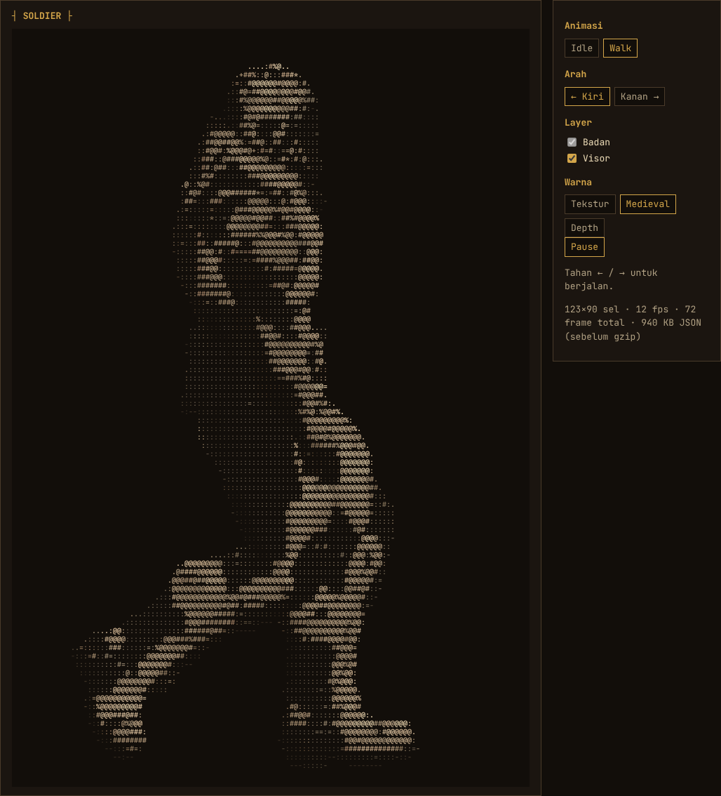

# ascii-bake-lab

Eksperimen pipeline **baked ASCII** untuk portfolio MMORPG medieval: model 3D (glTF) di-render sekali menjadi frame ASCII
(char + depth + warna per sel), lalu diputar di browser tanpa Three.js.


## Menjalankan

```bash
npm install
npm run dev
```

- `http://localhost:5173/bake.html?model=knight` → **bake tool** (dev only, pakai Three.js). Atur parameter, klik **Bake**, lalu
  **Simpan ke public/baked/knight.json** (endpoint dev di `vite.config.ts`) atau **Download JSON**.
- `http://localhost:5173/` → **player** (produksi, tanpa Three.js). Idle/walk, arah kiri/kanan (mirror), toggle layer,
  mode warna Tekstur/Medieval/Depth. Tahan ← / → untuk berjalan.
- `npm run build` hanya mem-build player. Hasil saat ini: JS 5,5 KB (2,7 KB gzip), Three.js tidak ikut.

## Cara kerja bake

1. Load `assets/models/kaykit/Knight.glb`, kamera **orthographic samping** (`yaw -90`, hadap kanan, `pitch 8`).
2. Framing diukur dari silhouette semua pose (bukan bounding box geometri, karena bbox skinned mesh terlalu longgar).
   Tinggi model = `rows`. `cols = 0` berarti lebar grid otomatis.
3. Per layer (badan, helm, senjata, perisai) dan per frame: render warna (lit) + depth ke render target
   `cols*6 × rows*12` px, lalu tiap sel diringkas jadi:
   - **char**: shape vector 2×3 region dari kecerahan sub-pixel, dicocokkan ke glyph JetBrains Mono Bold terdekat
     (charset ramp `.:-=+*#%@`). Ini yang memberi volume dan tepi silhouette, beda dengan `AsciiEffect` Three.js yang
     hanya rata-rata brightness.
   - **depth**: 0..254 (255 = kosong), dinormalisasi ke rentang depth model.
   - **warna**: rata-rata warna lit, dikuantisasi ke palet 32 warna bersama.
4. Frame di-crop ke bounding box sel terisi, depth/warna disimpan sebagai base64 Uint8Array.

Runtime (`src/shared/compose.ts`): untuk tiap sel, pilih layer dengan depth terkecil. Mirror = balik kolom +
tukar glyph asimetris (`/`↔`\`, `(`↔`)`, dst). Canvas menggambar per run warna yang sama, ligature font dimatikan.

## Hasil saat ini (Knight, 4 layer × 2 clip × 13 frame @12fps)

| | Ukuran |
|---|---|
| Grid | 99 × 60 sel (lebar karena pedang ke depan dan perisai di belakang; badan saja ±48 kolom) |
| `knight.json` | 624 KB mentah, **121 KB gzip** |
| Per layer (mentah) | badan 246 KB, helm 176 KB, senjata 121 KB, perisai 81 KB |
| Player JS | 5,5 KB (2,7 KB gzip) |

Ruang optimasi yang belum dikerjakan: format biner + delta antar frame, palet 16 warna (4 bit), fps 8–10.

## Uji proporsi realistis (non-chibi)

`/bake.html?model=soldier` dan `/?model=soldier`. Model **Soldier** dari contoh Three.js (karakter Mixamo "Vanguard"),
tinggi 90 baris, layer badan + visor. Tujuannya membuktikan proporsi seperti referensi ansenjeo, bukan aset final
(bukan medieval).



| | |
|---|---|
| Grid | 123 × 90 (lebar karena langkah walk; badan saat idle ±30 kolom) |
| `soldier.json` | 940 KB mentah, **176 KB gzip** (2 layer × 2 clip × 12 frame) |

File `.glb` **tidak di-commit** karena lisensi Mixamo melarang redistribusi file mentah (hasil render/bake boleh
dipakai di project). Untuk bake ulang:

```bash
mkdir -p assets/models/threejs-examples
curl -o assets/models/threejs-examples/Soldier.glb \
  https://raw.githubusercontent.com/mrdoob/three.js/dev/examples/models/gltf/Soldier.glb
```

Kandidat aset final non-chibi medieval: Quaternius "Modular Character Outfits – Fantasy" + "Universal Animation
Library" (diklaim CC0 dan modular, cocok untuk layer customization; lisensi belum diverifikasi karena situsnya tidak
bisa diakses dari cloud), atau karakter + animasi Mixamo. Tambahkan preset baru di `src/bake/presets.ts`.

## Aset

Model: **KayKit Character Pack: Adventurers 1.0** (Kay Lousberg), lisensi **CC0 1.0** (sudah diverifikasi dari repo
resmi, salinan lisensi di `assets/models/kaykit/LICENSE.txt`, detail di `assets/models/kaykit/SOURCE.md`).

Kalau perlu menaruh aset sendiri: unduh pack dari https://kaylousberg.itch.io/kaykit-adventurers atau repo GitHub
`KayKit-Game-Assets/KayKit-Character-Pack-Adventures-1.0`, salin `Characters/gltf/<Nama>.glb` ke
`assets/models/kaykit/`, lalu sesuaikan import di `src/bake/main.ts` dan nama mesh di `DEFAULT_PARAMS.layers`
(`src/bake/bake.ts`).

## Struktur

```
bake.html, src/bake/        bake tool (Three.js, dev only)
index.html, src/player/     player (produksi)
src/shared/                 format JSON, compose, renderer canvas (tanpa Three.js)
public/baked/knight.json    hasil bake
assets/models/kaykit/       model CC0 + lisensi
docs/PLAN.md                rencana portfolio lengkap
```
