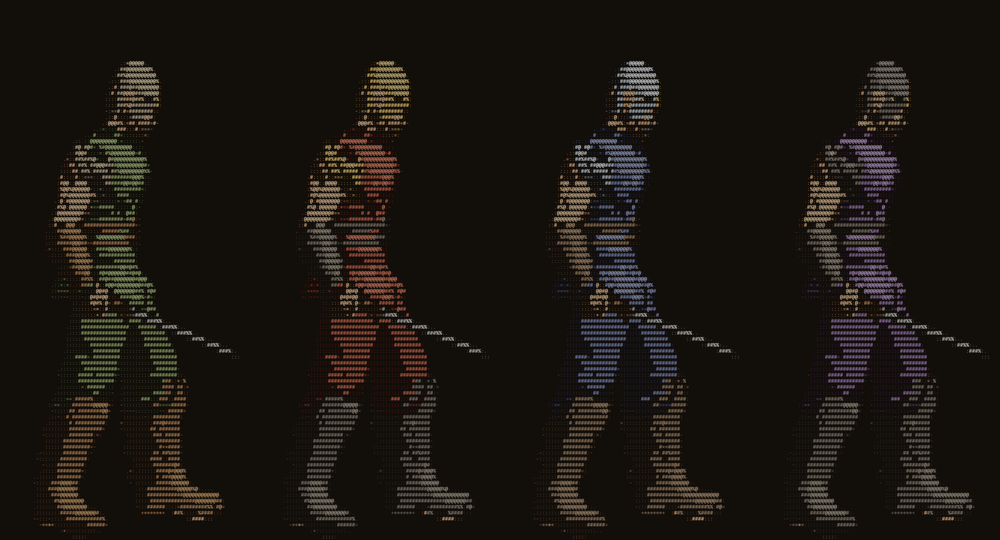
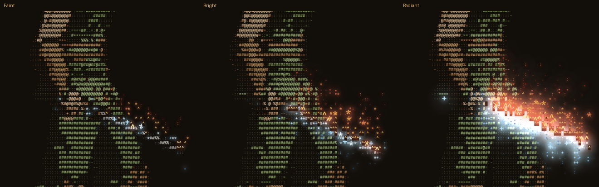
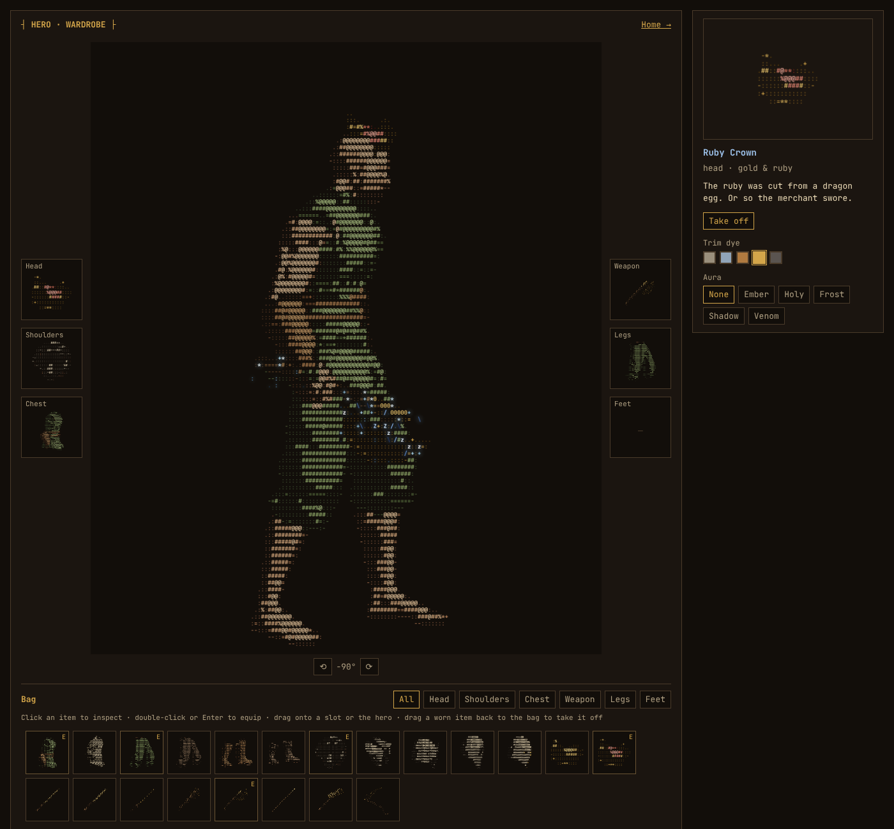
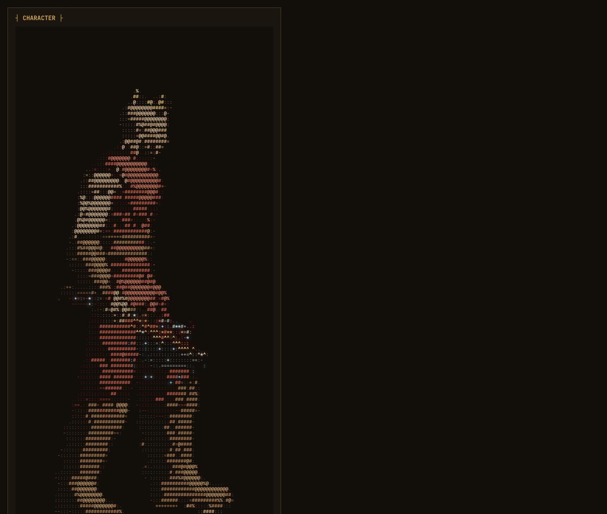
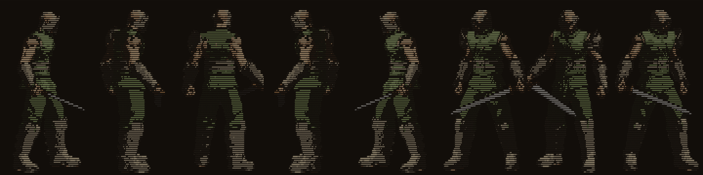

# ascii-bake-lab

A **baked ASCII** character pipeline for a medieval MMORPG-themed portfolio. 3D models (glTF/FBX) are rendered once
into ASCII frames that store a **shade level, part id and depth** per cell, then played back in the browser without
Three.js. The final glyph and colour come from a **material** at runtime, so equipment, dyes, blade materials and
particle effects change without re-baking.


## Running it

```bash
npm install
npm run dev
```

- `http://localhost:5173/bake.html` → **bake tool** (dev only, uses Three.js). Tune the parameters, click **Bake**, then
  save to `public/baked/hero.bake` (a dev endpoint in `vite.config.ts`, gzip level 9) or download JSON for debugging.
  `/bake.html?model=hero-turn` bakes the 16-direction file.
- `http://localhost:5173/` → **Tavern player** (production, no Three.js): an inventory-style wardrobe with idle/walk,
  16-direction turning, equipment per slot, dyes, blade materials, runes and auras. Hold ← / → to walk.
- `http://localhost:5173/home.html` → **Home prototype**: the same character with the visitor's saved loadout.
- `npm run build` type-checks and builds only the player and `home.html`. Three.js is not included.

## How baking works

1. Load the body (`.gltf`/`.glb`/`.fbx`), animations from separate files (`animations: { idle: 'file.glb#Clip' }`),
   skinned outfits re-bound to the body skeleton (`outfits`), and accessories attached to bones (`attachments`, meshes
   named `<name>:<material>`). The camera is **orthographic, side view** (`yaw -90`, facing right, `pitch 8`).
2. Framing is measured from the silhouette of every pose, not the geometry bounding box (skinned bounding boxes are
   too loose). Model height = `rows`; `cols = 0` sizes the grid automatically.
3. For each layer and frame, three passes are rendered to a `cols*6 × rows*12` px target (lit colour, depth, part id)
   and summarised per cell. Lit colour is blended with an untextured pass (`albedo` 0.5), so shade follows lighting
   more than texture colour and dark cloth does not turn into sparse glyphs.
   - **Shade level**: a 2×3 shape vector of sub-pixel brightness, matched to the closest JetBrains Mono Bold glyph in
     the ramp `.:-=+*#%@`. That glyph's index (0..8) is the shade level, so silhouette edges survive even though the
     final character is chosen at runtime.
   - **Part id**: the majority part in the cell. Parts are set per mesh in the preset (`layers.<x>.parts`). A weapon
     mesh can be split along a local axis (`blade: { mesh, axis, at, below, above }`).
   - **Depth**: 0..254 (255 = empty), normalised to the model's depth range and quantised by `depthStep`
     (4 ≈ 1.8 cm) so gzip compresses it better.
4. Weapon layers also store a **blade socket** per frame (`base` and `tip` in grid coordinates `[x, y, depth]`),
   which the rune emitter uses.
5. Frames are cropped to their filled cells: one byte per cell (`part * 16 + shade`) plus one depth byte.
6. Everything is written to a binary `.bake` container (`packBake` in `format.ts`): gzip( magic `ASB3` | header length
   | JSON header | cell plane | depth plane ). All cells come before all depths because gzip does better that way.
   The player loads it with `DecompressionStream`, so it does not depend on the server's Content-Encoding. Frame
   deltas were tested and came out larger (a moving character turns XOR into noise), so they are not used.

Full format: `src/shared/format.ts` (BakeFile v2).

Some items are simulated at bake time: the cloak, long beard and hood cape as cloth (`src/bake/cloth.ts`), and the
flail chain with Verlet integration (`src/bake/flail.ts`). Chainmail is a copy of the peasant tunic (`copies` in the
preset) with a ring pattern applied in the bake shader.

## Equipment

Every equipment variant is **one bake layer** with a `slot` field. File size grows with the number of layers, not with
combinations, and all variants are baked in one run so they share framing and depth range. The player composes at most
one layer per slot (`activeLayers` / `defaultEquipment` in `compose.ts`); swapping equipment only changes which layers
are composed, with no re-decoding. Every weapon layer has its own blade split and socket, so blade materials and runes
work on all weapons. Metal parts of blunt weapons count as `blade` (forgeable, rune source); wood stays `wood`.

The current bake has **61 items in 10 slots**:

| Slot | Items |
|---|---|
| Head | Iron Helm, Knight Helm, Noble Helm, Gold Crown, Ruby Crown, Halo, Shadow Hood |
| Hair | Buzzed Hair, Long Hair, Parted Hair |
| Beard | Beard, Sage Beard |
| Shoulders | Ranger Pauldron, Knight Pauldrons, Fur Mantle |
| Chest | Ranger Jerkin, Peasant Tunic, Leather Cuirass, Iron Cuirass, Steel Cuirass, Blackguard Cuirass, Golden Cuirass, Duelist Cuirass, Chainmail Hauberk, Wayfarer Robe, Tattered Shroud |
| Back | Wanderer Cloak, Fallen Wings, Angel Wings, Broken Wings, Longbow & Quiver |
| Weapon | Longsword, Shortsword, Katana, Mace, Bearded Axe, Spear, War Hammer, Reaper Scythe, Claymore, Bastard Sword, Gilded Sword, Dagger, Double Axe, Smith Hammer, Flail |
| Off-hand | Heater Shield, Banded Heater, Round Shield, Painted Round Shield, Celtic Shield |
| Legs | Ranger Trousers, Woolen Breeches, Iron Greaves, Duelist Cuisses |
| Feet | Ranger Boots, Wrapped Shoes, Iron Sabatons, Duelist Boots |


## Dyes and blade materials

Cloth, leather, linen, wool, plate, helmets, trim, cloaks, feathers, plumage and hair can be dyed from the player (`DYEABLE` in `materials.ts`).
A dye only swaps the material's colour stops (glyphs still come from the baked ramp), so no re-bake is needed. Fabrics
use 11 `DYES` (Moss, Crimson, Indigo, Royal purple, Ochre, Tan, Umber, Parchment, Snow, Raven, Charcoal), metal uses
5 `FINISHES` (Iron, Steel, Bronze, Gold, Blackened), and hair has its own five colours. Dyes apply per part, so every
item sharing that part changes together.

Blades have four forge materials with their own glyph pairs: Iron `#%`, Steel `@%`, Gold `0o`, Bloodiron `B8`.



## Runes and auras

`src/shared/runes.ts` draws glyph particles in four layers: the cells under each glyph are cleared, a radial-gradient
halo is added with `lighter` blending (bloom), small glyphs snap to the grid, and occasional 2× glyphs float freely.

- **Runes** spawn along the blade socket: Fire, Lightning, Blood, Venom, Frost.
- **Auras** spawn on the silhouette edge of an item (cells of that layer next to empty space or another layer), one
  per slot: Ember, Holy, Frost, Shadow, Venom. Compose records the owning layer of each cell (`Grid.owner`), so this
  needs no extra data in the file.
- Intensity per effect: **Faint / Bright / Radiant** (`LEVELS`), scaling particle count, spread, lifetime, large-glyph
  chance and halo size.
- A layer with `fx` (a list of parts) emits only from those parts, e.g. the flail emits from its chain and ball, not
  the handle (`runeSpawn` / `auraSpawn`).
- Particles update every animation frame (the sprite stays at 12 fps) and turn off completely under
  `prefers-reduced-motion`.



## Tavern inventory

The player is a game-style inventory (English UI, no stats):

- **Paper doll**: the character in the centre (still turnable) with slots on both sides. Clicking a slot filters the bag.
- **Bag**: every variant as an icon. Click to inspect, double-click or Enter to equip or remove, drag onto a matching
  slot or the character to equip, drag a worn item back to the bag to take it off.
- **Item detail**: name, type and a short lore line (`src/shared/items.ts`), then the options that apply to that item:
  blade material, rune, dye, aura and effect level.
- **Icons** are generated at runtime from the item's own layer (first idle frame, cropped; `src/shared/icons.ts`), so
  they need no extra files and follow dyes and materials.
- Debug controls (clip, direction, colour mode, socket markers) live in the **Dev** panel.



## Loadout (Tavern → Home)

Everything chosen in the player (equipment, dyes, blade material, auras, runes, effect levels) is saved as a loadout in
the visitor's `localStorage` (`src/shared/loadout.ts`, key `ascii-hero-loadout`) and restored on the next visit.
`home.html` loads `hero.bake` first so the character appears right away, then `hero-turn.bake` in the background so it
can be turned (drag or ⟲ ⟳). Values the bake no longer knows (a removed layer, a renamed palette entry) fall back to the
bake defaults. Each visitor has their own loadout; without one, the default outfit is shown.



## Turning (16 directions, breathing idle)

The `hero-turn` preset bakes **4 idle frames** (`stillFrames: 4`) from **16 full directions** (`views`: 0°, −22.5° …
−337.5°) for every layer into `public/baked/hero-turn.bake` (`TurnFile`). There is no mirroring: the character is not
symmetric (one-sided pauldron, weapon in the right hand), and mirroring made items jump sides while turning. All
directions share framing, depth range and auto-levels, and the grid is centred on the model origin so the character
does not shift while turning.

In the player, drag the character or use ⟲ ⟳ (22.5° steps). The baked side view (−90°) uses the animated `hero.bake`
(idle and walk); walking the other way mirrors `hero.bake`, as in a 2D game. Every other direction cycles the four idle
frames (one breath every 2.5 s). Both files are aligned through `origin` (the point between the feet, stored in every
BakeFile).



## Runtime

- `src/shared/compose.ts`: each cell takes the layer with the smallest depth minus the layer's `bias`, so armour wins
  over skin that is only a few centimetres in front of it. Mirroring flips columns and sockets.
- `src/shared/materials.ts`: a material is a glyph per shade level plus dark → light colour stops, with defaults per
  part (skin, plate, cloth, leather, wood, …). Low levels stay `.:-=` so edges never disappear.
- `src/shared/ascii-canvas.ts`: materials compile into a 256-entry table (cell byte → glyph + colour), so changing a
  material rebuilds the table without re-decoding frames. Asymmetric glyphs are swapped when mirrored (`/` ↔ `\`, …).
- `src/shared/runes.ts`: rune and aura emitters (see above).

## Character and assets

One realistically proportioned character (not chibi), 90 rows tall. Third-party assets are **CC0** from Quaternius;
everything marked "own" was generated procedurally by a script in its folder.

| Layer | Source | Folder |
|---|---|---|
| Body | Universal Base Characters, `Superhero_Male` | `assets/models/quaternius-ubc/` |
| Animation | Universal Animation Library: `Idle_Loop`, `Walk_Loop`, `Sword_Idle` (trimmed) | `assets/models/quaternius-ubc/` |
| Ranger and peasant outfits | Modular Character Outfits – Fantasy (`Male_Ranger`, `Male_Peasant`) | `assets/models/quaternius-outfits/` |
| Helmets, swords, katana, mace, knight pauldrons | Animated Knight Pack | `assets/models/quaternius/` |
| Axes, spear, hammers, scythe, extra swords, shields, crowns, cuirasses, bow | Modular Weapons Pack + Ultimate RPG Pack | `assets/models/quaternius-weapons/` |
| Cloak | own (`make_cloak.py`), cloth-simulated at bake time | `assets/models/cloak/` |
| Fallen, Angel and Broken wings | own (`make_wings.py`) | `assets/models/wings/` |
| Iron greaves and sabatons | own (`make_greaves.py`) | `assets/models/greaves/` |
| Halo and long beard | own (`make_accessories.py`), beard cloth-simulated | `assets/models/accessories/` |
| Duelist cuirass | own (`make_cuirass.py`) | `assets/models/cuirass/` |
| Wayfarer robe and tattered shroud | own (`make_robe.py`) | `assets/models/robe/` |
| Shadow hood and cape | own (`make_hood.py`), cape cloth-simulated | `assets/models/hood/` |
| Fur mantle | own (`make_mantle.py`) | `assets/models/mantle/` |
| Quiver | own (`make_quiver.py`) | `assets/models/quiver/` |
| Flail | own (`make_flail.py`), chain simulated with Verlet | `assets/models/flail/` |

Download sources and licence notes are in each folder's `SOURCE.md` (taken from GitHub mirrors because the Quaternius
site was not reachable from the build environment). The free Modular Outfits pack only contains the ranger and peasant
outfits.

Character fixes worth knowing about:

- **Sword grip**: the free idle/walk clips do not hold a weapon, so the right arm and fingers are locked to frame 0 of
  `Sword_Idle` (`overlays` in the preset). The hand closes on the hilt and the sword does not swing with the arm.
- **Skin poking through clothes**: the body is larger than the outfit's base body, so outfits are inflated 2 cm along
  their normals at bake time (`outfitInflate`) and armour layers get a 4 cm `bias` when composing.


## Current output

| | |
|---|---|
| Grid | 107 × 90 (`hero-turn`: 162 × 90, symmetric around the origin, wide enough for open wings) |
| `hero.bake` | 60 layers × 2 clips (idle, walk) @ 12 fps = **555 KB** |
| `hero-turn.bake` | 16 directions × 60 layers × 4 frames = **1.0 MB** |
| Player + Home JS | ~37 KB (~15.5 KB gzip), no Three.js |

The portfolio loads `hero.bake` for the character and only fetches `hero-turn.bake` where turning is needed. Ideas not
yet implemented: a lower frame rate (8–10 fps) and per-layer files loaded on demand.

## Project layout

```
bake.html, src/bake/        bake tool (Three.js, dev only)
index.html, src/player/     Tavern player (production)
home.html, src/home/        Home prototype: character with the saved loadout
src/shared/                 .bake format, compose, loadout, items, icons, runes, canvas renderer (no Three.js)
public/baked/*.bake         baked output (gzip binary container)
assets/models/*/            CC0 and procedural models, each with SOURCE.md or a generator script
docs/PLAN.md                original portfolio plan (Indonesian)
```
