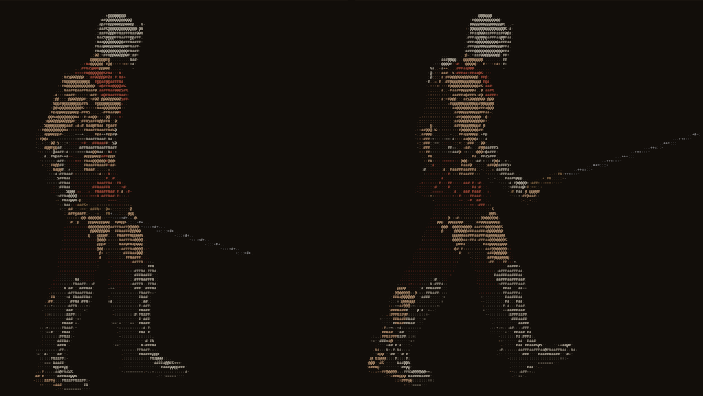

# ascii-bake-lab

Eksperimen pipeline **baked ASCII** untuk portfolio MMORPG medieval: model 3D (glTF) di-render sekali menjadi frame ASCII
(**shade level + part id + depth** per sel), lalu diputar di browser tanpa Three.js. Glyph dan warna final ditentukan
**material** di runtime, jadi material bisa diganti tanpa re-bake.



## Menjalankan

```bash
npm install
npm run dev
```

- `http://localhost:5173/bake.html` → **bake tool** (dev only, pakai Three.js). Atur parameter, klik **Bake**, lalu
  **Simpan ke public/baked/hero.json** (endpoint dev di `vite.config.ts`) atau **Download JSON**.
- `http://localhost:5173/` → **player** (produksi, tanpa Three.js). Idle/walk, arah kiri/kanan (mirror), toggle layer,
  material blade (Iron/Steel/Gold/Bloodiron), rune api, mode warna Material/Part/Depth, penanda socket blade.
  Tahan ← / → untuk berjalan.
- `npm run build` hanya mem-build player. Hasil saat ini: JS 7,8 KB (3,8 KB gzip), Three.js tidak ikut.

## Cara kerja bake

1. Load badan (`.gltf`/`.glb`/`.fbx`), animasi dari file terpisah (`animations: { idle: 'file.glb#Clip' }`), outfit skinned
   yang di-bind ulang ke skeleton badan (`outfits`), dan aksesori yang ditempel ke tulang (`attachments`, mesh-nya
   bernama `<name>:<material>`). Kamera **orthographic samping** (`yaw -90`, hadap kanan, `pitch 8`).
2. Framing diukur dari silhouette semua pose (bukan bounding box geometri, karena bbox skinned mesh terlalu longgar).
   Tinggi model = `rows`. `cols = 0` berarti lebar grid otomatis.
3. Per layer (badan, armor, helm, senjata) dan per frame: render 3 pass ke render target `cols*6 × rows*12` px
   (warna lit, depth, part id), lalu tiap sel diringkas jadi:
   - **shade level**: shape vector 2×3 region dari kecerahan sub-pixel, dicocokkan ke glyph JetBrains Mono Bold terdekat
     di ramp `.:-=+*#%@`. Index glyph itu = shade level (0..8). Jadi tepi silhouette dari shape vector tetap terbawa,
     walau char final baru dipilih di runtime.
   - **part id**: part mayoritas di sel. Part diatur per mesh di preset (`layers.<x>.parts`). Mesh senjata bisa dibagi dua
     di sepanjang sumbu lokalnya (`blade: { mesh, axis, at, below, above }`). Pedang Quaternius sudah terpisah per
     material, jadi `sword:Metal` = blade dan sisanya hilt.
   - **depth**: 0..254 (255 = kosong), dinormalisasi ke rentang depth model.
4. Layer senjata juga menyimpan **socket blade** per frame: `base` (titik potong hilt/blade) dan `tip`, dalam koordinat
   grid `[x, y, depth]`. Dipakai emitter partikel rune.
5. Frame di-crop ke bounding box sel terisi. Satu byte per sel `part * 16 + shade` + satu byte depth, base64.

Format lengkap: `src/shared/format.ts` (BakeFile v2). File v1 (char final) tidak didukung lagi.

## Runtime

- `src/shared/compose.ts`: tiap sel pilih layer dengan depth terkecil. Mirror = balik kolom; socket ikut di-mirror.
- `src/shared/materials.ts`: material = glyph per shade level + stop warna gelap→terang. Look default per part
  (kulit, pelat, kain, kulit samak, kayu) plus 4 material blade dari reel ansenjeo (`#%` Iron, `@%` Steel, `0o` Gold,
  `B8` Bloodiron). Level rendah tetap `.:-=` supaya tepi tidak hilang.
- `src/shared/ascii-canvas.ts`: material dikompilasi jadi tabel 256 entri (byte sel → glyph + warna), jadi ganti material
  = bangun ulang tabel, tanpa decode ulang frame. Glyph asimetris ditukar saat mirror (`/`↔`\`, dst).
- `src/shared/runes.ts`: rune api = emitter partikel glyph (`^^*:.`) di sepanjang socket blade, warna sesuai umur + glow.
  Partikel diupdate tiap rAF (sprite tetap 12 fps) dan **mati total saat `prefers-reduced-motion`**.

## Karakter

Satu karakter proporsi realistis (bukan chibi), tinggi 90 baris. Semua aset **CC0** dari Quaternius:

| Layer | Aset | Folder |
|---|---|---|
| Badan | Universal Base Characters, `Superhero_Male` | `assets/models/quaternius-ubc/` |
| Animasi | Universal Animation Library, `Idle_Loop` + `Walk_Loop` (dipangkas, 380 KB) | `assets/models/quaternius-ubc/` |
| Armor | Modular Character Outfits – Fantasy, outfit `Male_Ranger` (tanpa lengan dan hood) | `assets/models/quaternius-outfits/` |
| Helm, pedang | Animated Knight Pack (`Helmet1`, `Sword`; ada juga Helmet2/3, ShortSword, Katana, Club) | `assets/models/quaternius/` |

Sumber unduhan dan catatan lisensi ada di `SOURCE.md` tiap folder (diambil dari mirror GitHub karena situs Quaternius
tidak bisa diakses dari cloud). Versi gratis Modular Outfits hanya berisi Ranger dan Peasant; outfit armor penuh ada di
versi berbayar.

Catatan yang masih terbuka:
- Animasi idle/walk gratis tidak menggenggam senjata, jadi pedang ikut ayunan lengan (saat walk blade terayun ke
  belakang dan melebarkan grid).
- Badan Superhero lebih besar dari tubuh untuk outfit Ranger, jadi kulit terlihat di celah rompi.
- Warna material per part belum di-tuning untuk karakter ini.

## Hasil saat ini (hero, 4 layer × 2 clip @12fps)

| | |
|---|---|
| Grid | 158 × 90 (lebar karena ayunan pedang saat walk; badan sendiri ±35 kolom) |
| `hero.json` | 1,55 MB mentah / **250 KB gzip** |
| Player JS | ±8 KB (±4 KB gzip), tanpa Three.js |

Ruang optimasi yang belum dikerjakan: format biner (tanpa base64) + delta antar frame, fps 8–10, crop grid per clip.

## Struktur

```
bake.html, src/bake/        bake tool (Three.js, dev only)
index.html, src/player/     player (produksi)
src/shared/                 format JSON, compose, renderer canvas (tanpa Three.js)
public/baked/hero.json      hasil bake
assets/models/quaternius*/  model CC0 + SOURCE.md
docs/PLAN.md                rencana portfolio lengkap
```
