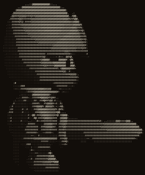
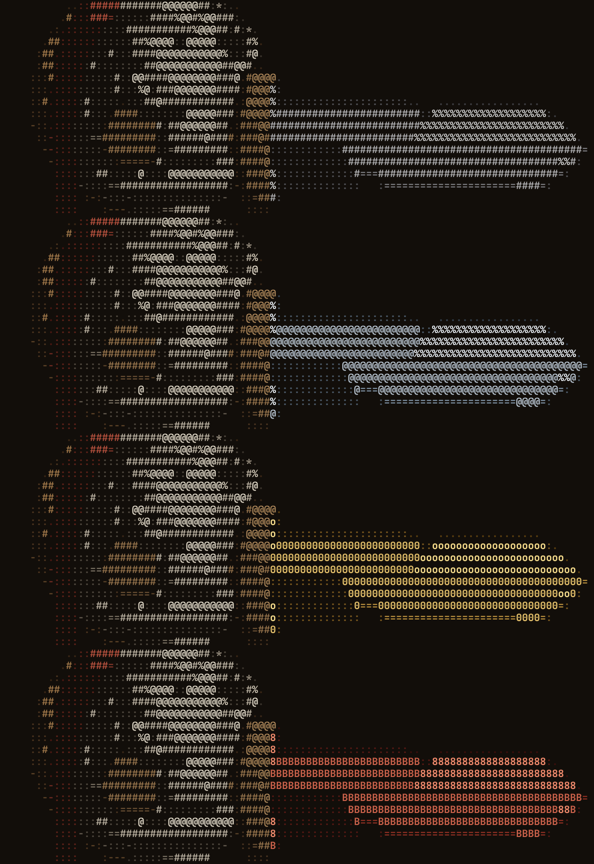
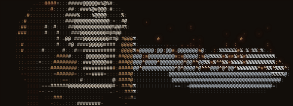

# ascii-bake-lab

Eksperimen pipeline **baked ASCII** untuk portfolio MMORPG medieval: model 3D (glTF) di-render sekali menjadi frame ASCII
(**shade level + part id + depth** per sel), lalu diputar di browser tanpa Three.js. Glyph dan warna final ditentukan
**material** di runtime, jadi material bisa diganti tanpa re-bake.



## Menjalankan

```bash
npm install
npm run dev
```

- `http://localhost:5173/bake.html?model=knight` → **bake tool** (dev only, pakai Three.js). Atur parameter, klik **Bake**, lalu
  **Simpan ke public/baked/knight.json** (endpoint dev di `vite.config.ts`) atau **Download JSON**.
- `http://localhost:5173/` → **player** (produksi, tanpa Three.js). Idle/walk, arah kiri/kanan (mirror), toggle layer,
  material blade (Iron/Steel/Gold/Bloodiron), rune api, mode warna Material/Part/Depth, penanda socket blade.
  Tahan ← / → untuk berjalan.
- `npm run build` hanya mem-build player. Hasil saat ini: JS 7,8 KB (3,8 KB gzip), Three.js tidak ikut.

## Cara kerja bake

1. Load `assets/models/kaykit/Knight.glb`, kamera **orthographic samping** (`yaw -90`, hadap kanan, `pitch 8`).
2. Framing diukur dari silhouette semua pose (bukan bounding box geometri, karena bbox skinned mesh terlalu longgar).
   Tinggi model = `rows`. `cols = 0` berarti lebar grid otomatis.
3. Per layer (badan, helm, senjata, perisai) dan per frame: render 3 pass ke render target `cols*6 × rows*12` px
   (warna lit, depth, part id), lalu tiap sel diringkas jadi:
   - **shade level**: shape vector 2×3 region dari kecerahan sub-pixel, dicocokkan ke glyph JetBrains Mono Bold terdekat
     di ramp `.:-=+*#%@`. Index glyph itu = shade level (0..8). Jadi tepi silhouette dari shape vector tetap terbawa,
     walau char final baru dipilih di runtime.
   - **part id**: part mayoritas di sel. Part diatur per mesh di preset (`layers.<x>.parts`). Mesh senjata bisa dibagi dua
     di sepanjang sumbu lokalnya (`blade: { mesh, axis, at, below, above }`), mis. pedang KayKit: `hilt` (pommel–guard)
     dan `blade`.
   - **depth**: 0..254 (255 = kosong), dinormalisasi ke rentang depth model.
4. Layer senjata juga menyimpan **socket blade** per frame: `base` (titik potong hilt/blade) dan `tip`, dalam koordinat
   grid `[x, y, depth]`. Dipakai emitter partikel rune.
5. Frame di-crop ke bounding box sel terisi. Satu byte per sel `part * 16 + shade` + satu byte depth, base64.

Format lengkap: `src/shared/format.ts` (BakeFile v2). File v1 (char final) tidak didukung lagi.

## Runtime

- `src/shared/compose.ts`: tiap sel pilih layer dengan depth terkecil. Mirror = balik kolom; socket ikut di-mirror.
- `src/shared/materials.ts`: material = glyph per shade level + stop warna gelap→terang. Look default per part
  (kulit, pelat, kain, kulit samak, kayu) plus 4 material blade dari reel ansenjeo (`#%` Iron, `@%` Steel, `0o` Gold,
  `B8` Bloodiron). Level rendah tetap `.:-=` supaya tepi tidak hilang.
- `src/shared/ascii-canvas.ts`: material dikompilasi jadi tabel 256 entri (byte sel → glyph + warna), jadi ganti material
  = bangun ulang tabel, tanpa decode ulang frame. Glyph asimetris ditukar saat mirror (`/`↔`\`, dst).
- `src/shared/runes.ts`: rune api = emitter partikel glyph (`^^*:.`) di sepanjang socket blade, warna sesuai umur + glow.
  Partikel diupdate tiap rAF (sprite tetap 12 fps) dan **mati total saat `prefers-reduced-motion`**.





## Hasil saat ini (Knight, 4 layer × 2 clip × 13 frame @12fps)

| | v1 (char + depth + warna) | v2 (shade+part + depth) |
|---|---|---|
| Grid | 99 × 60 | 99 × 60 |
| `knight.json` | 624 KB mentah / 121 KB gzip | **456 KB mentah / 86 KB gzip** |
| `soldier.json` (90 baris, 2 layer) | 940 KB / 176 KB gzip | **684 KB / 109 KB gzip** |
| Player JS | 5,5 KB (2,7 KB gzip) | 7,8 KB (3,8 KB gzip) |

Grid knight lebar karena pedang ke depan dan perisai di belakang; badan saja ±48 kolom.
Ruang optimasi yang belum dikerjakan: format biner (tanpa base64) + delta antar frame, fps 8–10.

## Uji proporsi realistis (non-chibi)

`/bake.html?model=soldier` dan `/?model=soldier`. Model **Soldier** dari contoh Three.js (karakter Mixamo "Vanguard"),
tinggi 90 baris, layer badan + visor. Tujuannya membuktikan proporsi seperti referensi ansenjeo, bukan aset final
(bukan medieval).


| | |
|---|---|
| Grid | 123 × 90 (lebar karena langkah walk; badan saat idle ±30 kolom) |
| `soldier.json` | 940 KB mentah, **176 KB gzip** (2 layer × 2 clip × 12 frame) |

File `.glb` **tidak di-commit** karena lisensi Mixamo melarang redistribusi file mentah (hasil render/bake boleh
dipakai di project). Untuk bake ulang:

```bash
mkdir -p assets/models/threejs-examples
curl -o assets/models/threejs-examples/Soldier.glb \
  https://raw.githubusercontent.com/mrdoob/three.js/dev/examples/models/gltf/Soldier.glb
```

Kandidat aset final non-chibi medieval: Quaternius "Modular Character Outfits – Fantasy" + "Universal Animation
Library" (diklaim CC0 dan modular, cocok untuk layer customization; lisensi belum diverifikasi karena situsnya tidak
bisa diakses dari cloud), atau karakter + animasi Mixamo. Tambahkan preset baru di `src/bake/presets.ts`.

## Aset

Model: **KayKit Character Pack: Adventurers 1.0** (Kay Lousberg), lisensi **CC0 1.0** (sudah diverifikasi dari repo
resmi, salinan lisensi di `assets/models/kaykit/LICENSE.txt`, detail di `assets/models/kaykit/SOURCE.md`).

Kalau perlu menaruh aset sendiri: unduh pack dari https://kaylousberg.itch.io/kaykit-adventurers atau repo GitHub
`KayKit-Game-Assets/KayKit-Character-Pack-Adventures-1.0`, salin `Characters/gltf/<Nama>.glb` ke
`assets/models/kaykit/`, lalu sesuaikan import di `src/bake/main.ts` dan nama mesh di `DEFAULT_PARAMS.layers`
(`src/bake/bake.ts`).

## Struktur

```
bake.html, src/bake/        bake tool (Three.js, dev only)
index.html, src/player/     player (produksi)
src/shared/                 format JSON, compose, renderer canvas (tanpa Three.js)
public/baked/knight.json    hasil bake
assets/models/kaykit/       model CC0 + lisensi
docs/PLAN.md                rencana portfolio lengkap
```
